## Setting the legal limit with an R package {.aims-title background-image="aims/title-background.jpg" background-size="cover"}

::: {.footer}
:::

::: {.title-sub}
fifteen years of open-source software in environmental regulation
:::

::: {.title-author}
Dr Rebecca Fisher
[R Exchange Perth · 15 October 2026]{.title-event}
:::

{.absolute .collage top="40" left="590" width="690" fig-alt="A dredging vessel at sea."}

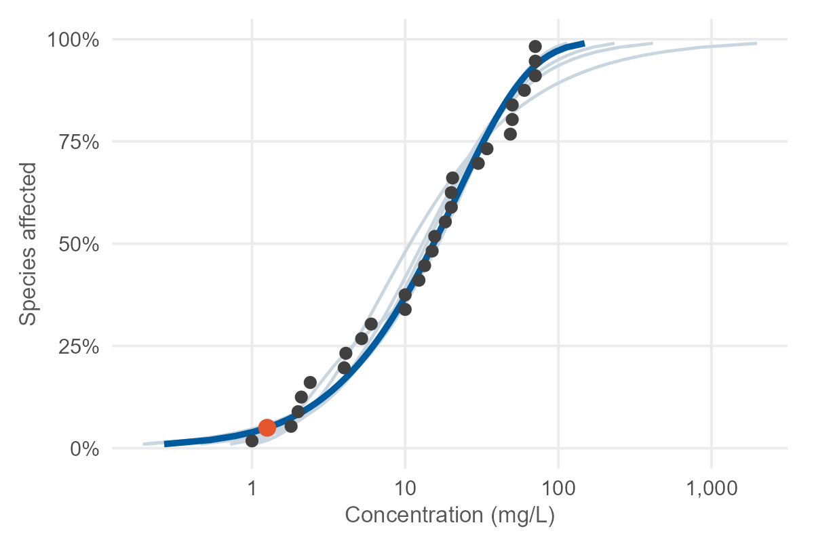{.absolute .collage top="250" left="1190" width="380" fig-alt="A species sensitivity distribution: toxicity estimates for individual species with fitted curves."}

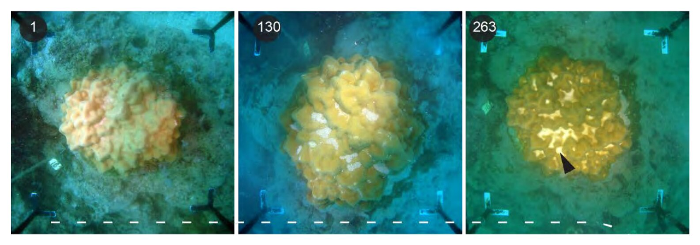{.absolute .collage top="560" left="760" width="760" fig-alt="Three photographs of the same coral colony at Barrow Island on days 1, 130 and 263 of dredging, showing sediment build-up and bleaching."}

::: {.notes}
> Wait to be introduced.

[~5 s]
:::

---

## Australian Institute of Marine Science {.bg-only background-image="aims/aims-intro.jpg" background-size="contain" background-color="#FFFFFF"}

::: {.footer}
:::

::: {.notes}
For those who don't know me, I'm a quantitative ecologist at the Australian Institute of
Marine Science. AIMS is a government-funded marine science agency, with sites in
Townsville, Perth and Darwin. Our research supports the sustainable growth, management and
protection of tropical marine ecosystems.

[~20 s]
:::

---

## Tropical Ecotoxicology and Risk Assessment {.bg-only background-image="aims/aims-team.jpg" background-size="contain" background-color="#FFFFFF"}

::: {.footer}
:::

::: {.notes}
I work in the tropical ecotoxicology and risk assessment team, which has people at all three
AIMS sites. We work closely with industry on contamination and pollution: dredging,
pesticides, produced water from oil and gas, oil spills and decommissioning. Much of that
work ends in a guideline value or a threshold, and a lot of what I'll talk about today came
out of work with this team.

> Check before presenting that the people on this slide are current.

[~30 s]
:::

---

## The legal limit

::: {.columns}

::: {.column width="62%"}

::: {.say}
Water quality guideline values set the safe concentration of a contaminant, for example
from a sewage outfall or from offshore oil and gas.
:::

::: {.say .fragment fragment-index="1"}
Default guideline values are the environmental equivalent of the
[0.05 blood alcohol driving limit]{.hl}.
:::

::: {.arrows .say .fragment fragment-index="2"}
- above the limit, activities can be stopped or modified
- below it, the environment is assumed to be "safe"
:::

::: {.say .fragment fragment-index="3"}
Dredging is managed the same way, against limits on turbidity and light.
:::

::: {.lede .fragment fragment-index="4" style="margin-top:0.6em;"}
Increasingly, these limits come out of open-source R code.
:::

:::

::: {.column width="38%"}
:::

:::

{.absolute .photo top="150" left="1080" width="430" fig-alt="Discharge pipes pouring brown effluent into water."}

{.absolute top="172" left="1200" width="190" fig-alt="A red prohibition sign."}

{.absolute .photo .fragment data-fragment-index="1" top="470" left="1080" width="430" fig-alt="A police officer holding a breath-testing device to a driver."}

{.absolute .fragment data-fragment-index="1" top="640" left="990" width="170" fig-alt="A police cap."}

::: {.notes}
Environmental regulation runs on numbers like these.

> Click: the blood-alcohol limit.

> Click: above and below the limit.

> Click: dredging.

> Click: the last line.

This talk is about how that happened in my own work, over about fifteen years.

[~40 s]
:::

---

## Code and regulation, 2010–2026

::: {.say style="margin-bottom:0.2em;"}
The R code I've written or contributed to, by how it was shared.
:::

::: {.r-stack}
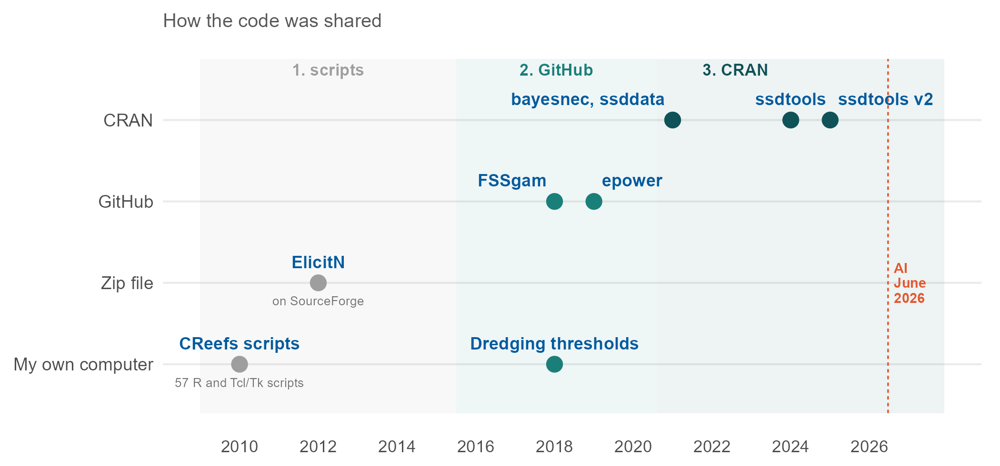{.stack-fig fig-alt="Timeline from 2010 to 2026 of the speaker's R code, by how it was shared: own computer, zip file, GitHub or CRAN. CReefs scripts in 2010 and the dredging thresholds in 2018 stayed on her own computer; ElicitN in 2012 was a zip file on SourceForge; FSSgam and epower are on GitHub; bayesnec, ssddata and ssdtools are on CRAN. Three shaded eras, scripts, GitHub and CRAN, and a marker for AI in June 2026."}

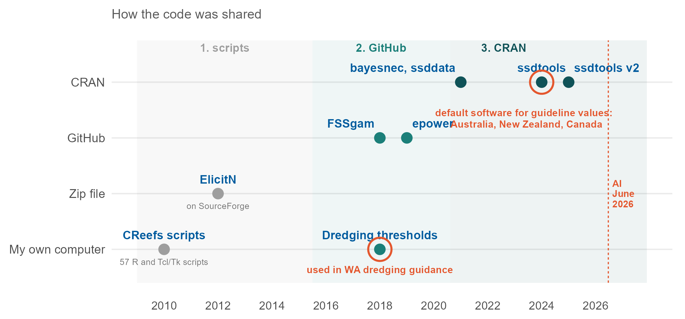{.stack-fig .fragment fig-alt="The same timeline, with two points circled as used in regulation: the dredging thresholds, used in WA dredging guidance, and ssdtools, the default software for guideline values in Australia, New Zealand and Canada."}
:::

::: {.lede .fragment style="text-align:center; margin-top:0.2em;"}
Regulators use the results of both. Only `ssdtools` can be run by anyone else.
:::

::: {.notes}
I have a good applied understanding of statistics, but no formal training in programming.
This is the code I've written or contributed to since about 2010, plotted by how it was
shared: on my own computer, as a zip file, on GitHub, or on CRAN.

> Click: the two used in regulation.

> Click: the last line.

I'll go through this from left to right, in three eras.

[~45 s]
:::

---

## [Era one · 2010–2015]{.kicker} ElicitN

::: {.columns}

::: {.column width="50%"}
Software for structured expert elicitation.\
*Environmental Modelling & Software*, 2012.

::: {.minor}
with R.A. O'Leary, S. Low-Choy, K. Mengersen & M.J. Caley
:::

::: {.arrows .say style="margin-top:0.5em;"}
- 25 R scripts of statistics
- 32 more running a Tcl/Tk interface
- distributed as a zip file, on SourceForge
- no package, no tests, no version control
:::

:::

::: {.column width="50%"}

::: {.minor style="margin-bottom:0.2em;"}
What it was used for: the number of species on coral reefs worldwide
:::

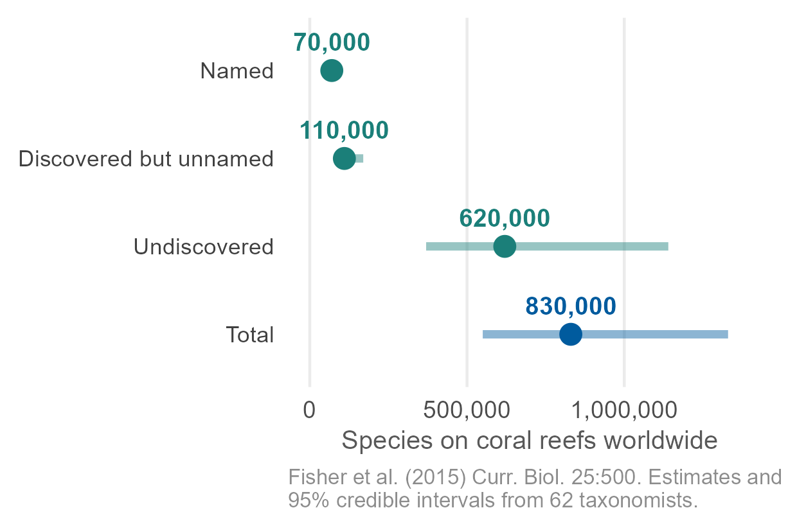{.panel width="100%" fig-alt="Estimates of species richness on coral reefs worldwide with 95% credible intervals: 70,000 named species, 110,000 discovered but unnamed, 620,000 undiscovered, and 830,000 in total, with an interval from 550,000 to 1,330,000."}

:::

:::

::: {.punch .fragment style="font-size:1.1em; margin-top:0.4em;"}
Effectively unreproducible within [five years]{.e3}.
:::

::: {.minor .fragment style="text-align:center;"}
Five of us wrote the paper, three of them statisticians. None of us thought to ask whether it
would still run.
:::

::: {.notes}
Era one produced scripts, not software. ElicitN was a real collaboration, and the
elicitation methods were the statisticians' at least as much as mine. We used it with 62
taxonomists to estimate the number of species on coral reefs, published in *Current
Biology* in 2015.

> Click: unreproducible.

> Click: the last line.

[~45 s]
:::

---

## [Era two · 2015–2020]{.kicker} White, grey and black literature

::: {.columns .lit}

::: {.column width="32%"}
{.lit-img fig-alt="A collage of journal covers including Nature, Science and Cell."}

::: {.say}
Scientific papers are [white]{.lit-white} literature.
:::
:::

::: {.column width="32%" .fragment}
{.lit-img fig-alt="A word cloud of grey literature types: reports, theses, slides, blogs and wikis."}

::: {.say}
Reports and theses are [grey]{.lit-grey}.
:::
:::

::: {.column width="32%" .fragment}
::: {.lit-black}
{.lit-img fig-alt="A red CONFIDENTIAL stamp."}
{.lit-box fig-alt="A black box."}
:::

::: {.say}
Industry monitoring data is [black]{.lit-black-word}.
:::
:::

:::

::: {.lede .fragment style="text-align:center; margin-top:0.6em;"}
High quality, very large, and confidential.
:::

::: {.notes}
At the same time I started working with industry data.

> Click: grey literature.

> Click: black literature.

> Click: the last line.

[~30 s]
:::

---

## [Era two · 2015–2020]{.kicker} Barrow Island monitoring data

::: {.columns}

::: {.column width="56%"}

::: {.say}
Approval conditions for dredging off the Pilbara coast required a lot of environmental
monitoring.
:::

::: {.arrows .say}
- more than **1,500 coral colonies**, photographed every two weeks for nearly two years
- water quality logged every **10 minutes**
- sites close to the dredging, so a gradient of exposure
:::

::: {.lede .fragment style="margin-top:0.6em;"}
I have never seen a monitoring program like it replicated. No research funding scheme would
cover anything close.
:::

:::

::: {.column width="44%"}
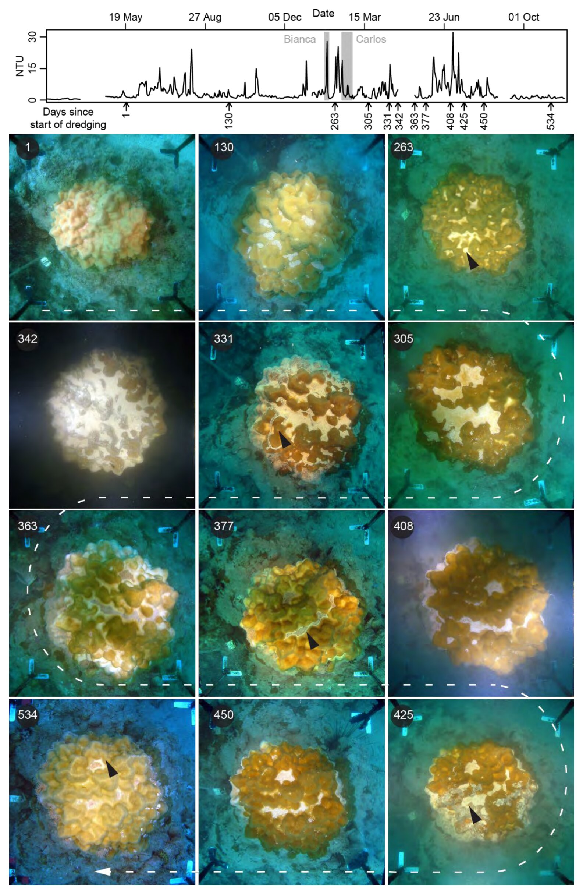{height="600px" fig-alt="Twelve photographs of one massive Porites coral colony taken through the Barrow Island dredging campaign, beneath a plot of turbidity over the same period. The photographs show sediment settling on the colony, bleaching, a mucous sheet, and recovery."}

::: {.credit}
One colony, days 1 to 534. Fisher, Jones & Bessell-Browne (2019) WAMSI Dredging Science Node
Report 4, Project 4.9, Fig. 6. CC BY 3.0 AU.
:::

:::

:::

::: {.notes}
This is one coral from that program, photographed through the dredging campaign, with the
turbidity record above it. You can see sediment settling, bleaching, and recovery.

> Click: the last line.

[~35 s]
:::

---

## [Era two · 2015–2020]{.kicker} Dredging exposure

::: {.absolute top="185" left="150" width="800"}

::: {.say}
Water quality every 10 minutes, at each monitoring site
:::

::: {.say}
Three pressure pathways for corals:
:::

::: {.arrows .say}
- suspended sediment
- light
- sediment settling on the coral
:::

::: {.say}
→ metrics of exposure to dredging for each site
:::

:::

{.absolute top="150" left="1010" width="510" fig-alt="A triangle of three dredging pressures, suspended sediment, light availability and sediment covering, with photographs of each and the positions of sponge, coral, barnacle and seagrass inside it."}

{.absolute .strip top="712" left="150" width="1380" fig-alt="A long time series of water quality, with three overlaid traces."}

::: {.notes}
From the water quality data we derived metrics of exposure to dredging, across the three
ways dredging affects corals.

[~20 s]
:::

---

## [Era two · 2015–2020]{.kicker} Coral mortality

::: {.absolute top="185" left="150" width="1380"}

::: {.say}
Each colony photographed every two weeks, at impact and control sites
:::

::: {.say}
Relative mortality = impact − control\
→ the probability of non-zero mortality at each site
:::

:::

{.absolute top="385" left="260" width="1160" fig-alt="Posterior densities of relative coral mortality for each monitoring site, from no mortality on the left to some mortality on the right. One site's density is shaded red where mortality is above zero, labelled probability of non-zero mortality."}

{.absolute .strip top="712" left="150" width="1380" fig-alt="A row of photographs of coral colonies."}

::: {.notes}
From the coral photographs we estimated, for each site, the probability that mortality was
above that at the control sites.

[~25 s]
:::

---

## [Era two · 2015–2020]{.kicker} Concentration–response in the field

{.absolute .panel top="150" left="590" width="420" fig-alt="Probability of coral mortality against light stress, a 14-day running mean, with a fitted S-shaped curve. Sites with low stress have near-zero mortality; sites with high stress have high mortality."}

::: {.absolute top="200" left="1060" width="470"}
::: {.say}
Exposure metrics from the water quality data
:::

::: {.say}
\+ probability of mortality from the coral photographs
:::

::: {.say}
→ a concentration–response relationship, from field data
:::
:::

{.absolute top="560" left="150" width="1380" fig-alt=""}

{.absolute .strip top="712" left="150" width="1380" fig-alt="A row of photographs of coral colonies."}

{.absolute .strip top="712" left="150" width="1380" fig-alt="Water quality traces drawn over the coral photographs."}

::: {.notes}
Putting the two together gives a concentration–response relationship from field data rather
than from a laboratory.

[~20 s]
:::

---

## [Era two · 2015–2020]{.kicker} Thresholds from error rates

{.absolute .panel top="150" left="590" width="420" fig-alt="The same concentration–response curve."}

{.absolute .panel top="150" left="1050" width="470" fig-alt="An ROC curve of true positive rate, or statistical power, against false positive rate, or false alarm rate, with a high-power threshold and a low-alarm-rate threshold marked."}

::: {.absolute top="185" left="150" width="420"}
::: {.say}
A threshold has error rates.
:::

::: {.arrows .say}
- false alarm: financial loss to the developer
- missed impact: coral mortality
:::
:::

::: {.absolute top="600" left="150" width="1380"}
::: {.arrows .say}
- [high power]{.thr-possible} threshold (lower value) → coral mortality possible
- [low alarm rate]{.thr-probable} threshold (higher value) → coral mortality probable
:::

::: {.credit}
Fisher, Walshe, Bessell-Browne & Jones (2018) *J. Appl. Ecol.* 55:415.
:::
:::

::: {.notes}
We set the thresholds from ROC curves, because a threshold has error rates on both sides.
The two thresholds suit different decisions.

[~35 s]
:::

---

## [Era two · 2015–2020]{.kicker} Thresholds in dredging management

{.absolute top="150" left="554" width="735" fig-alt="The concentration–response curve with the probable and possible mortality thresholds marked as vertical lines, projected down onto a plot of impact against distance from the dredge, where they mark the edges of the zones of high impact, moderate impact and influence."}

{.absolute top="250" left="150" width="380" fig-alt="The cover of the WA EPA Technical Guidance on environmental impact assessment of marine dredging proposals, December 2016, beside a map of zones around a dredging site."}

::: {.absolute top="640" left="150" width="380"}
::: {.credit}
WA EPA (2016) Technical Guidance: Environmental Impact Assessment of Marine Dredging
Proposals.
:::
:::

::: {.lede .fragment .absolute top="760" left="150" width="1380" style="text-align:center;"}
Still in regulatory use. The code was written for one project and never packaged.
:::

::: {.notes}
The probable-mortality threshold marks the edge of the zone of high impact, and the
possible-mortality threshold marks the edge of the zone of moderate impact.

> Click: the last line.

The code behind them was written for this one project, and it cannot be separated from data
I'm not able to share.

[~30 s]
:::

---

## [Era two · 2015–2020]{.kicker} Industry work and packages

::: {.columns}

::: {.column width="48%"}
### Industry work

::: {.arrows}
- large, high-quality data
- real regulatory stakes
- thresholds still in use
- code written for one project
- [nothing anyone else can run]{.e3}
:::

:::

::: {.column width="52%" .fragment}
### Packages on GitHub

::: {.arrows}
- `FSSgam` (2018), `epower` (2019)
- public and installable
- built on data I *could* share
- no regulation depends on them
- still no tests, not on CRAN
:::

:::

:::

::: {.punch .fragment style="font-size:1.05em; margin-top:0.6em;"}
The higher the stakes, the less shareable the tooling.
:::

::: {.notes}
Era two was really two strands. On the left is the industry work: the data and the
regulatory stakes, with code that only works on data I can't distribute.

> Click: the packages column.

Alongside it I started putting packages on GitHub. FSSgam began as a function for one paper
and became a package because people kept asking for it. epower is a toolbox for the power
of before–after control–impact designs, from an industry-funded project with BMT. Both are
public and installable, and no regulation depends on either. They could become packages
because they were built on data I could share. There were still no tests, and neither was
on CRAN.

> Click: the last line.

The higher the stakes, the less shareable the tooling. Separating a method from
confidential data well enough to release it is a lot of work, it is rarely anyone's funded
deliverable, and I didn't do it. I don't think our field has solved this.

> If Adam Sparks's privacy-preserving pipelines talk (1:45pm) touched on this, say so here.

[~65 s]
:::

---

## [Era three · 2021 onwards]{.kicker} Packages on CRAN

::: {.cran}
**`bayesnec`** concentration–response modelling, to estimate "no effect"\
[with D. Barneche, G. Ricardo & D. Fox · *J. Stat. Softw.* 2024]{.minor}

**`ssddata`** toxicity data sets for species sensitivity distributions\
[on CRAN, with `bayesnec`, by November 2021]{.minor}

**`ssdtools`** species sensitivity distributions\
[J. Thorley & C. Schwarz, British Columbia · v2 with D. Fox and me, *JOSS* 2025]{.minor}
:::

::: {.punch .fragment style="font-size:1.1em; margin-top:0.7em;"}
The first time anything outside my own judgement checked my code against a standard.
:::

::: {.minor .fragment style="text-align:center;"}
`R CMD check` reports the same problems every time, and CRAN will not accept a package until
they are fixed.
:::

::: {.notes}
In 2021 Diego Barneche and I released bayesnec on CRAN, with ssddata. Like ssdtools,
bayesnec averages over several models rather than choosing one.

> Click: the first time.

> Click: R CMD check.

[~35 s]
:::

---

## [Era three · 2021 onwards]{.kicker} Species sensitivity distributions

::: {.columns}

::: {.column width="38%"}

::: {.say}
Each point is the toxicity estimate for one species, from a concentration–response
experiment.
:::

::: {.say .fragment fragment-index="1"}
Fit a distribution.
:::

::: {.say .fragment fragment-index="2"}
Read off the concentration that protects 95% of species: the PC95.
:::

::: {.lede .fragment fragment-index="3"}
That becomes the default guideline value, the equivalent of the 0.05.
:::

:::

::: {.column width="62%"}

::: {.r-stack}
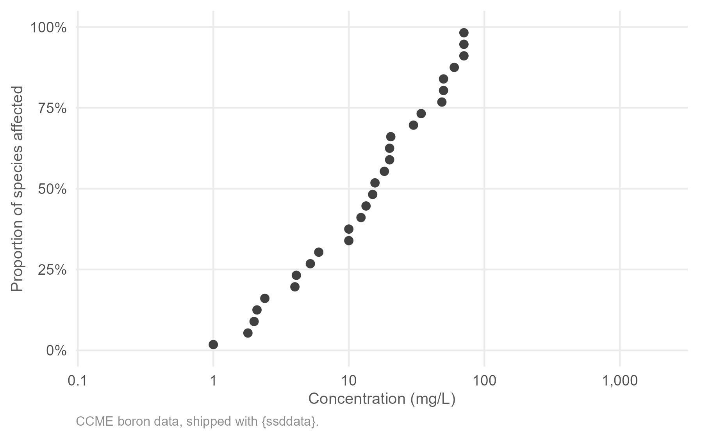{.stack-fig fig-alt="Toxicity estimates for individual species from the CCME boron data, plotted as the proportion of species affected against concentration on a log scale."}

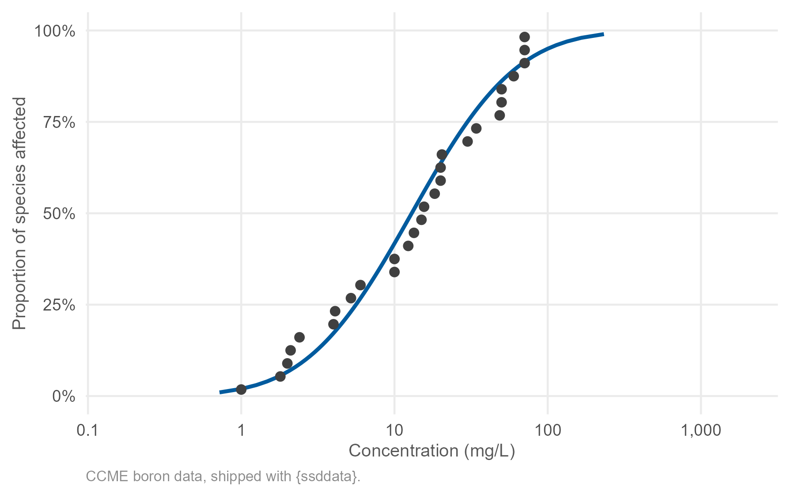{.stack-fig .fragment data-fragment-index="1" fig-alt="The same points with a fitted log-normal distribution."}

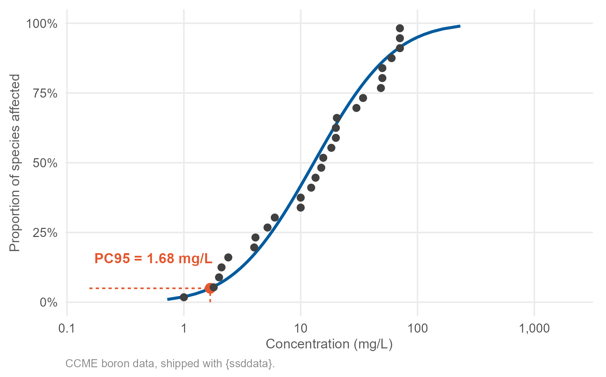{.stack-fig .fragment data-fragment-index="2" fig-alt="The log-normal fit with the concentration affecting 5% of species marked: PC95 = 1.68 mg/L."}
:::

:::

:::

::: {.notes}
The default guideline values are derived from a species sensitivity distribution, or SSD.
bayesnec estimates the points; ssdtools fits the curve.

> Click: fit a distribution.

> Click: the PC95.

> Click: the guideline value.

[~35 s]
:::

---

## [Era three · 2021 onwards]{.kicker} Choice of distribution

::: {.columns}

::: {.column width="38%"}

::: {.say}
Many distributions fit these data, with no theoretical basis for choosing one.
:::

::: {.say .fragment fragment-index="1"}
Burrlioz 2.0, the software required in Australia at the time, fitted one.
:::

::: {.lede .fragment fragment-index="2"}
`ssdtools` averages over several, weighted by AICc.
:::

:::

::: {.column width="62%"}

::: {.r-stack}
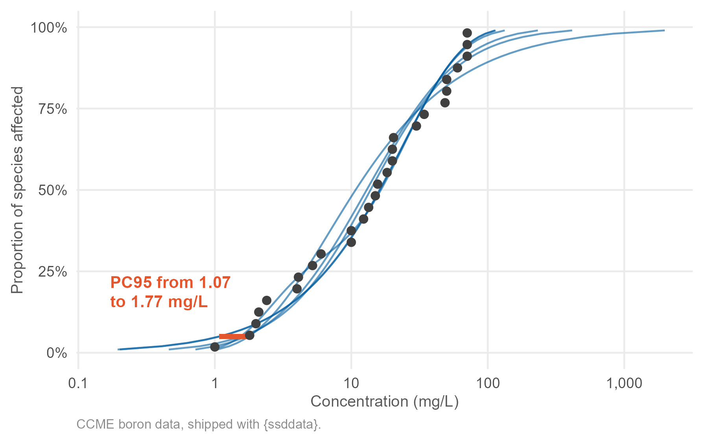{.stack-fig fig-alt="Six distributions fitted to the same boron data. Their PC95 values range from 1.07 to 1.77 mg/L."}

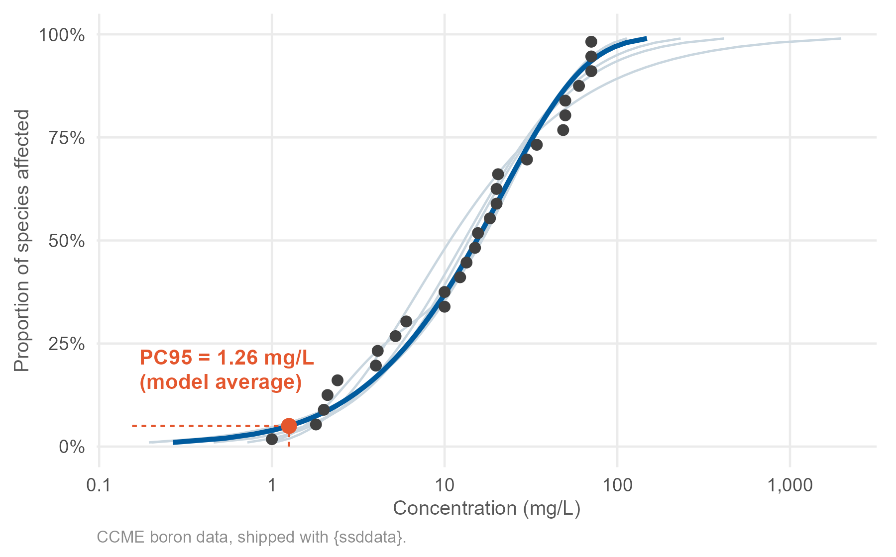{.stack-fig .fragment data-fragment-index="2" fig-alt="The six fits in light grey with the model average in bold, and its PC95 marked at 1.26 mg/L."}
:::

:::

:::

::: {.notes}
For these boron data the guideline value ranges from 1.07 to 1.77 milligrams per litre,
depending on which distribution you pick.

> Click: Burrlioz.

> Click: the model average.

[~35 s]
:::

---

## [Era three · 2021 onwards]{.kicker} Evaluation of `ssdtools`

::: {.columns}

::: {.column width="60%"}

::: {.say}
Joint Australian–Canadian project, funded by the Australian Government (DCCEEW)
:::

::: {.arrows .say}
- David Fox, Environmetrics Australia
- Joe Thorley & Carl Schwarz, British Columbia
:::

::: {.say .fragment}
`ssdtools` compared with Burrlioz 2.0, on benchmark data sets and on simulated data with a
known true value
:::

::: {.arrows .say .fragment}
- `ssdtools` performed better than Burrlioz
- more distributions improved its estimates
:::

:::

::: {.column width="40%"}

::: {.punch .fragment style="font-size:1.05em;"}
Recommendation:\
adopt `ssdtools` as the\
[default software]{.e3}
:::

::: {.minor style="text-align:center; margin-top:0.6em;"}
[Australia · New Zealand · Canada]{.fragment}
:::

:::

:::

::: {.minor .fragment style="margin-top:0.6em;"}
I was on the project because of years of work in the field and workshops with the people who
set these guidelines, not because of my GitHub profile.
:::

::: {.notes}
ssdtools was originally written by Joe Thorley and Carl Schwarz. The project's job was to
evaluate whether ssdtools could replace Burrlioz, and the stated aim was collective agreement
between the Australian and Canadian experts.

> Click: the comparison.

> Click: the results.

> Click: the recommendation.

> Click: the three countries.

The recommendation has since been approved.

> Click: the last line.

[~50 s]
:::

---

## Open source and regulatory agreement

::: {.punch style="margin-top:0.6em;"}
Three regulators cannot audit\
a [black box]{.e3}.
:::

{.absolute top="150" left="1230" width="120" fig-alt="A black box."}

::: {.say .fragment style="text-align:center; margin-top:1.0em;"}
Every expert could read the source code, run the benchmarks, and disagree about specific
lines.
:::

::: {.say .fragment style="text-align:center;"}
Most people deriving guideline values don't write R. The Shiny app, `shinyssdtools`, is how
they use the method.
:::

::: {.notes}
With a closed desktop program, the discussion ends up relying on trust in whoever wrote it.

> Click: reading the source.

> Click: the Shiny app.

[~30 s]
:::

---

## [Since June 2026]{.era-num} AI-assisted coding {.divider}

::: {.notes}
That brings me to the last few months.

[~5 s]
:::

---

## The change since June

::: {.lede style="margin-bottom:0.3em;"}
I stopped writing code by hand in [June]{.e3}.
:::

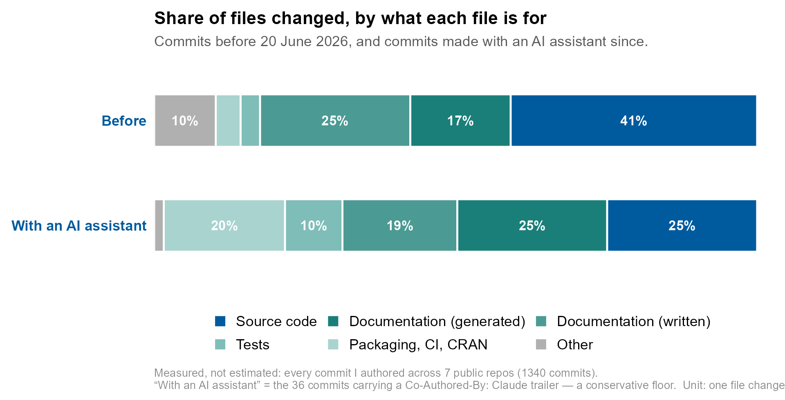{.fig-full style="max-height:560px;" fig-alt="Stacked bar chart of the share of files changed by category, before versus with an AI assistant, measured from 1,340 authored commits across seven public repositories. Tests rise from 3 to 10 per cent; packaging and CI from 4 to 20 per cent; source code falls from 41 to 25 per cent."}

::: {.notes}
In June I stopped writing code by hand. I now work with Claude Code, and my impression is
that I'm about five times more productive. That is an impression, so I measured what I
could.

This is every commit I've authored across seven public repositories, 1,340 of them, with
each file classified by what it is for. "With an AI assistant" means the commit includes a
Co-Authored-By: Claude line, which anyone can check.

Tests went from 3% of the files I changed to 10%. Packaging, continuous integration and CRAN
went from 4% to 20%. Source code went down, from 41% to 25%.

So the change is not in the typing. What has changed is that the work around the code now
gets done: the tests, documentation and continuous integration that determine whether
software still runs in five years.

[~60 s]
:::

---

## `FSSgam`, 2018 to 2026

::: {.columns}

::: {.column width="54%"}
First commit **14 September 2018**.

::: {.arrows}
- first test file: **20 June 2026**
- first CI workflow: **20 June 2026**
- **7 years and 9 months** with neither
:::

::: {.minor style="margin-top:0.7em;"}
Then, over **four days**: 32 commits, 9 test files, roxygen documentation, a pkgdown site,
`NEWS.md`, a snake_case interface with deprecation wrappers, and CRAN preparation.
:::

:::

::: {.column width="46%"}

::: {.punch style="font-size:1.1em;"}
Writing the tests found\
[two silent bugs]{.e3}\
present since 2018.
:::

:::

:::

::: {.notes}
One package in detail. FSSgam's first commit was in September 2018, and it went seven years
and nine months without a test file or continuous integration. There was always a more
pressing deadline.

Both arrived on the 20th of June this year. Over the next four days there were thirty-two
commits, nine test files, documentation, a pkgdown site and CRAN preparation.

Writing the tests found two bugs that had been there since 2018. A deprecated argument gave
the right warning and then did nothing. Two fields of the output came back NULL, because the
code read the wrong element names. Anyone using those features got the wrong result,
with no warning.

> If running long, drop this slide and say the last paragraph over the previous one.

[~50 s]
:::

---

## Routine work and judgement

::: {.columns}

::: {.column width="50%"}
### Now routine

::: {.arrows}
- test suites
- vignettes that stay current
- refactoring code that works
- continuous integration
- responding to CRAN
:::

:::

::: {.column width="50%"}
### Still mine

::: {.arrows}
- is this the right model?
- is the answer plausible?
- what would show it is wrong?
- is it defensible to a regulator?
:::

:::

:::

::: {.minor style="margin-top:0.6em;"}
The standard used to evaluate `ssdtools` and Burrlioz applies to code written by a model:
read the source, simulate with a known answer, check bias and coverage.
:::

::: {.notes}
The left column is work that used to be put off for the next deadline, and now gets done.
The right column has not changed. If anything it matters more, because I'm producing more
code for each hour of my own attention.

When we evaluated ssdtools against Burrlioz, we asked for the source code, benchmarks, and
simulations with a known answer. I don't get to lower that standard because a model wrote the code. The
methods I used for checking someone else's software are the ones I now use for this.

[~40 s]
:::

---

## Points to take away

::: {.arrows style="font-size:1.15em; margin-top:0.8em;"}
- The maintenance that determines whether research software outlives its project now
  takes far less time.
- We still have no good pattern for open, reusable tools built on
  [data that cannot be shared]{.e3}.
:::

::: {.notes}
Two things I'd like to leave you with.

First, the tests, documentation and continuous integration that determine whether
research software outlives its project now take far less time. If you are using AI to work
faster, spend some of the time saved on this work.

Second, we still don't have a good pattern for building open, reusable tools on data that
can't be shared. That gap is where a large amount of high-quality industry data stops being
useful to anyone except the client. If you've worked on this problem, I'd like to talk to
you.

[~40 s]
:::

---

## Contacts and acknowledgements

::: {.columns}

::: {.column width="55%"}
**Rebecca Fisher**\
Australian Institute of Marine Science\
[r.fisher@aims.gov.au](mailto:r.fisher@aims.gov.au)

::: {.minor style="margin-top:1.0em;"}
`ssdtools` · `bayesnec` · `epower` · `FSSgam` · `ElicitN`
:::

:::

::: {.column width="45%"}

::: {.arrows}
- [github.com/beckyfisher](https://github.com/beckyfisher)
- [github.com/open-AIMS](https://github.com/open-AIMS)
- [github.com/bcgov/ssdtools](https://github.com/bcgov/ssdtools)
:::

:::

:::

::: {.minor style="margin-top:1.2em;"}
With David Fox, Joe Thorley, Carl Schwarz, Diego Barneche, Gerard Ricardo, Ross Jones,
Pia Bessell-Browne, Andrew Negri, and the AIMS Tropical Ecotoxicology and Risk Assessment
team. Barrow Island data via the WAMSI Dredging Science Node (Chevron, Woodside, BHP).
:::

::: {.notes}
Thank you. The packages, the code for every figure in this talk, and the log of how I used
AI to prepare it are on GitHub. I'm happy to take questions in the session Q&A.

> The talk repository is private. Make it public before the talk, or drop the second
> sentence.

[~15 s]
:::

---

## Thresholds against turbidity events {visibility="uncounted"}

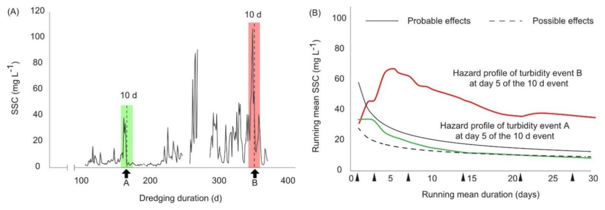{.fig-full style="max-height:520px;" fig-alt="Left: suspended sediment concentration at a monitoring site about 200 m from the dredging over 400 days, with two 10-day turbidity events marked A and B. Right: running-mean suspended sediment for each event plotted against the possible-effects and probable-effects thresholds. Event A exceeds the possible threshold only; event B exceeds both."}

::: {.credit style="text-align:center;"}
Adapted from Jones, Fisher, Bessell-Browne, Negri & Duckworth (2019) WAMSI Dredging Science
Node Theme 4 Synthesis Report, Fig. 19; panels placed side by side. CC BY 3.0 AU.
Thresholds from Fisher et al. (2018) *J. Appl. Ecol.* 55:415.
:::

::: {.notes}
> Backup for questions on how the thresholds are used during dredging.

On the left is suspended sediment about 200 metres from the dredge. On the right, two
turbidity events are plotted against the thresholds. Event A crosses the possible threshold
only. Event B is above both. An exceedance like that can result in changing how the dredge
operates, or stopping it.
:::

---

## Threshold setting with ROC curves {visibility="uncounted"}

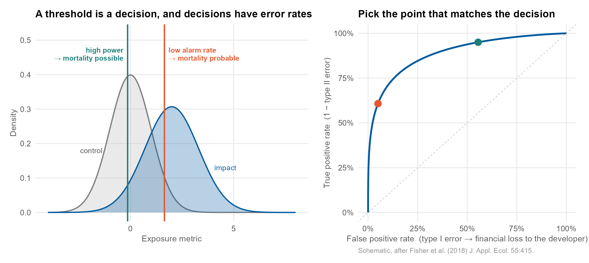{.fig-full fig-alt="Two panels. Left: overlapping control and impact distributions of an exposure metric with two thresholds marked, high power and low alarm rate. Right: the corresponding ROC curve with those two operating points marked."}

::: {.notes}
> Backup for questions on how the dredging thresholds were set.

For any threshold, the proportion of impact sites above it is the true positive rate, and
the proportion of control sites above it is the false positive rate. Varying the threshold
across its range traces out the ROC curve. The high-power threshold detects most impacts at the expense of
more false alarms; the low-alarm-rate threshold is exceeded only when mortality is
probable.
:::

---

## PC95 by distribution {visibility="uncounted"}

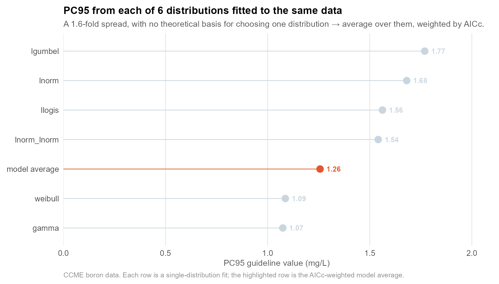{.fig-full fig-alt="Lollipop chart of the PC95 guideline value from six single-distribution fits to the same boron dataset, spanning 1.07 to 1.77 mg/L, with the model average highlighted at 1.26."}

::: {.notes}
> Backup for questions on model averaging.

The same boron data, fitted with each of the six distributions in turn. The guideline value
ranges from 1.07 to 1.77 mg/L, and there is no theoretical basis for choosing between them.
The model average weights each fit by its AICc.
:::

---

## Estimates of "no effect" {visibility="uncounted"}

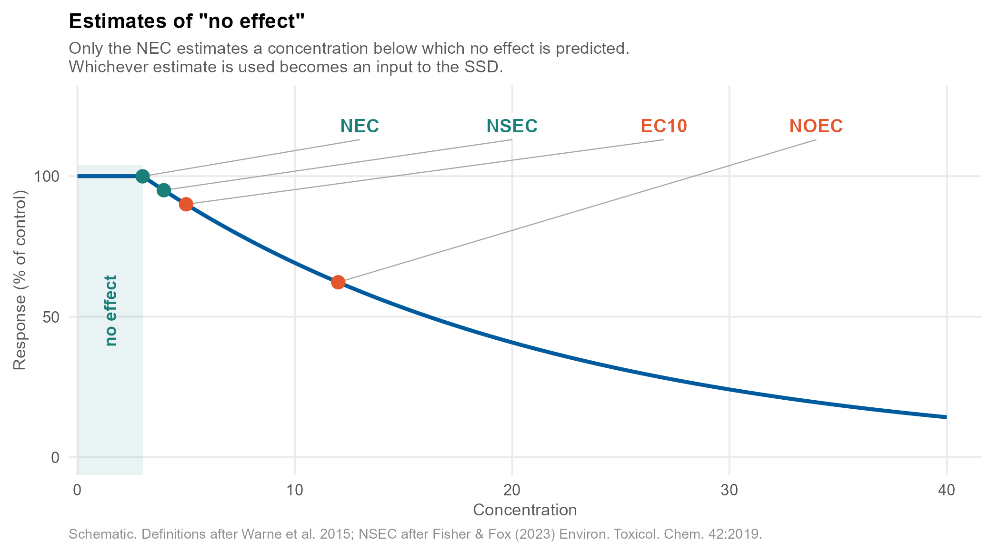{.fig-full fig-alt="Schematic concentration-response curve with four estimates marked and labelled: NEC, NSEC, EC10 and NOEC, with the region below the NEC shaded and labelled no effect."}

::: {.notes}
> Backup for questions on bayesnec and what goes into an SSD.

The NEC is the concentration below which no effect is predicted. The NSEC, which David Fox
and I defined, is the concentration at which the response cannot be distinguished from the
control. The EC10 is, by definition, a 10% effect. The NOEC is the highest tested
concentration not statistically different from the control, so it depends on which
concentrations were tested. Whichever is used becomes an input to the SSD.
:::
