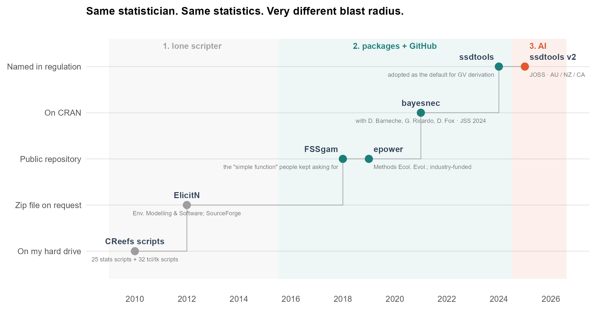
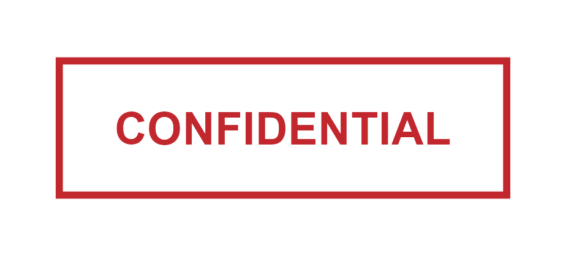
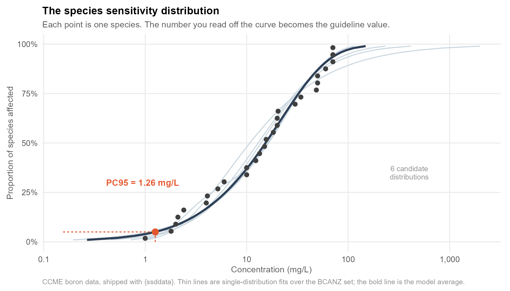

## When the next dredge works off the Pilbara coast {.smaller}

::: {.columns}

::: {.column width="52%"}
It will be running against a **number**.

If turbidity at the monitoring site crosses it, the vessel stops.

Someone has to defend that number to a regulator, a proponent, and possibly a lawyer.
:::

::: {.column width="48%"}
{width="42%" fig-alt="A stop sign."}

::: {.punch}
That number came out of\
**R code that I wrote**.
:::

:::

:::

::: {.notes}
> Open cold. Don't introduce yourself yet — earn the next 19 minutes first.

When the next dredge works off the Pilbara coast in WA, it will be running against a number.
If turbidity at the compliance monitoring site crosses that number, the vessel stops. That
costs a proponent a very large amount of money per day. Get the number wrong in the other
direction and you lose a coral reef.

Somebody has to be able to defend that number — to the regulator, to the proponent, and if
things go badly, to a court.

That number came out of R code that I wrote.

*(beat)*

Some of you in this room write code like that. I want you to sit with that for a second.

I'm going to tell you where that number came from, what happened to the code that produced
it, and how I ended up — fifteen years later — maintaining software that sets numbers like
it across three countries.

[~45 s]
:::

---

## [Part one]{.era-num} How I got here {.divider}

::: {.notes}
So: how does a person with no programming training end up responsible for that?

Badly, is the answer. Let me show you the shape of it.

[~10 s]
:::

---

## Fifteen years, three eras {.smaller}

{.fig-full fig-alt="Timeline from 2010 to 2026 plotting software artefacts against how far they could travel: hard drive, zip file on request, public repository, CRAN, named in regulation. Three shaded eras: scripts not software, GitHub, and CRAN, with a marker for AI in June 2026."}

::: {.notes}
First, who's talking. I'm a quantitative ecologist. I have a PhD in marine biology. I have
had exactly zero formal training in programming. What I had was a solid grasp of applied
statistics and a supply of real problems.

This is fifteen years of that. The dredging number from slide one is roughly in the middle —
2018, the second era.

The y-axis is the only thing I want you to take from this slide. It isn't "sophistication".
It's **how far the thing could travel**.

Same person throughout. And honestly, much the same statistics — I understood mixture
distributions in 2012 about as well as I do now. What changed was entirely about
distribution, maintenance and trust.

We're going to walk left to right.

[~55 s]
:::

---

## Era one: scripts, not software {.smaller}

::: {.columns}

::: {.column width="55%"}
**ElicitN** — software for rigorous expert elicitation.\
*Environmental Modelling & Software*, 2012.

::: {.aside}
with R.A. O'Leary, S. Low-Choy, K. Mengersen & M.J. Caley
:::

::: {.arrows}
- 25 scripts of statistics
- **plus 32 more** running a Tcl/Tk GUI
- run by `source()`-ing a control script
- distributed as a zip, on SourceForge
- no tests, no version control, no package
:::

:::

::: {.column width="45%"}

::: {.punch}
It worked.\
[And then it didn't.]{.e3}
:::

:::

:::

::: {.notes}
This is the paper I'm least embarrassed by and the software I'm most embarrassed by.

ElicitN was a tool for eliciting expert judgement rigorously — we used it to produce the
first expert-based estimate of global coral reef diversity.

And I want to be careful with the credit, because it matters to the point I'm about to make.
This was a real collaboration: Rebecca O'Leary, Sam Low-Choy, Kerrie Mengersen and Julian
Caley. The elicitation methodology was theirs at least as much as mine — Kerrie and Sam are
elicitation specialists; I was the ecologist who could write R.

So the science was collaborative. What was solitary was the **code**.

Fifty-seven R scripts. Twenty-five doing statistics, thirty-two more driving a Tcl/Tk
graphical interface, because the experts needed something to click on. You ran it by sourcing
a control script called `wElicitN.r`. You got it by emailing me, or off SourceForge.

Not a package. No tests. No version control. Nothing anywhere that would tell any of us if it
broke.

*(beat)*

And here's what I'd like you to notice. There were five of us on that paper. Three were
serious statisticians. Not one of us asked whether the software would still run in five
years.

That isn't a personal failing — it's what the norms were. And it's why I'm standing here.

[~75 s]
:::

---

::: {.punch}
The science outlived the software\
by about *fifteen years*.
:::

::: {.aside .center}
The code was mine. The blind spot was everyone's.
:::

::: {.notes}
> Pause here. Let it land.

This is the lesson I'd hand to anyone starting out: your paper will outlive your code by a
decade, and nobody warns you about that.

Peer review interrogated our statistics extremely thoroughly — five reviewers' worth of
scrutiny on the elicitation model. It asked precisely zero questions about whether the
software would still run in 2017.

[~30 s]
:::

---

## Era two: the data most of you will never see {.smaller}

::: {.columns}

::: {.column width="58%"}
Scientific literature is **white**.\
Reports and theses are **grey**.

::: {.punch style="text-align:left; margin-top:0.6em;"}
Industry monitoring data is [black]{.e3}.
:::

::: {.aside style="margin-top:0.8em;"}
One dredging campaign at Barrow Island: over **1,500 individual coral heads** scored every
two weeks for **530 days**, alongside water quality logged every **10 minutes**.

I have never seen a research grant that could fund data collection at that scale.
:::

:::

::: {.column width="42%"}
{width="82%" fig-alt="A red CONFIDENTIAL stamp."}
:::

:::

::: {.notes}
Era two, and the thing that changed everything for me: I stopped writing tools for
researchers and started working with industry data.

We talk about white literature — peer-reviewed papers — and grey literature — reports,
theses, things public but not indexed. I've started calling the third tier black. It's
industry monitoring data. Compliance data. It's real, it's enormous, it's high quality
because a regulator is watching, and it is confidential.

One example. A single capital dredging campaign at Barrow Island: over fifteen hundred
individual coral colonies, tagged and scored every fortnight, for five hundred and thirty
days. Water quality logged every ten minutes across three pressure pathways. No research
funding programme I have ever seen comes close.

Here's the tension, and it's the centre of my whole career: I cannot give you that data.
I genuinely cannot.

But I can give you the method. Open code is how black data becomes public good. The
dataset stays confidential; the thing we learned to do with it doesn't.

And that dataset is where the number on slide one came from.

[~90 s]
:::

---

## What that data bought: the number from slide one {.smaller}

{.fig-full fig-alt="Two panels. Left: overlapping control and impact distributions with two vertical thresholds marked high power and low alarm rate. Right: the corresponding ROC curve with those two operating points marked."}

::: {.notes}
> This is the payoff for slide one. Say so explicitly.

So — this is where that number came from.

At Barrow Island we had one receptor that mattered: coral, the habitat-forming organism.
One site, one dredging campaign. So we built the dose–response relationship *in situ* —
dredging exposure metrics on one axis, and on the other, the Bayesian posterior probability
of non-zero coral mortality at each site relative to the controls.

Then, to turn that into a threshold, we used ROC curves. Because a threshold is a decision
rule, and decision rules have error rates. A false positive costs a proponent money. A false
negative costs you a reef. Not symmetric, not commensurable, and almost nobody sets
thresholds with that in mind.

So you pick your operating point deliberately. A high-power threshold — cheap to trigger,
tells you mortality is *possible*. A low-alarm-rate threshold — hard to trigger, tells you
mortality is *probable*. Different management actions hang off each.

That's Fisher et al. 2018 in *Journal of Applied Ecology*.

And I want to flag something for later, because it matters: **there is no SSD anywhere in
this**. An SSD needs toxicity estimates across many species; we had one. This is a
site-specific number built from one campaign's data, and it long predates anything I did
with SSDs. Hold that thought — I'll show you the other kind of number shortly.

The transferable point: any time your software emits a threshold, someone downstream is
making a decision with asymmetric costs — and you have more influence over that than you
think.

[~75 s]
:::

---

## Era two, meanwhile: onto GitHub {.smaller}

::: {.columns}

::: {.column width="50%"}
**FSSgam** (2018) — full-subsets model selection.

::: {.aside}
Started as "a simple function". Became a package because people kept asking for it.
:::

**epower** (2019) — power analysis for BACI designs.

::: {.aside}
Industry-funded. *Methods in Ecology and Evolution*. Later used for the North West Shelf
seismic study.
:::

:::

::: {.column width="50%"}

::: {.arrows}
- I did not adopt GitHub to collaborate
- I adopted it so I could **send someone a working thing**
- collaboration was a side effect
- still no tests, still no CRAN
:::

:::

:::

::: {.notes}
Running alongside all of that — same years, 2018, 2019 — I finally started making packages.
And it began, honestly, with a filing problem.

FSSgam began life as a function I'd written for one paper. Then people emailed asking for
it. Then they emailed asking why it didn't work on their data. Making it a package was
self-defence.

Here's the part I think is under-said at open-science meetings: I did not go to GitHub for
collaboration. I went because I needed a way to send someone a thing that worked, that I
could then fix without re-emailing a zip file. The collaboration came later, and it came
as a surprise.

But be clear about what era two was and wasn't. It solved *distribution*. It did not make me
disciplined. There were still no tests, and nothing had been near CRAN.

[~85 s]
:::

---

## Era two: two strands that never met {.smaller}

::: {.columns}

::: {.column width="47%"}
### The industry work

::: {.arrows}
- enormous, high-quality data
- genuine regulatory stakes
- numbers **still in use today**
- bespoke code, one campaign
- [nothing anyone else can run]{.e3}
:::

:::

::: {.column width="53%"}
### The packages

::: {.arrows}
- `FSSgam`, `epower`
- public, installable, reusable
- no regulation depends on them
- built from data I *could* share
:::

:::

:::

::: {.punch style="font-size:1.0em; margin-top:0.5em;"}
The high-stakes work produced no reusable tool.\
[I still don't have a good answer for that.]{.e3}
:::

::: {.notes}
> This is the honest gap in the story. Don't smooth it over — it's the second take-home.

Now, I've just told you about era two twice, and I want to be straight about something: those
were two separate strands, and **they never properly came together**.

On one side, the industry work. Enormous datasets, real regulatory stakes, numbers that are
still being used today. And the code behind it was bespoke — written for one campaign, tangled
up with data I am contractually not allowed to distribute. There is no package. There is
nothing you could install and run.

On the other side, the packages. `FSSgam` and `epower` are public, installable, genuinely
reusable — and no regulation depends on either of them. They were built from data I *could*
share, which is exactly why they could become software.

*(beat)*

So the pattern is backwards. The higher the stakes, the less shareable the tooling. My most
consequential work produced the least reusable code, and my most reusable code came from my
least consequential work.

I did try. Building open tooling around confidential data means separating the method from the
data cleanly enough that the method can travel alone — synthetic test fixtures, worked
examples on public data, an API that doesn't assume the shape of one client's monitoring
programme. It is a lot of work, it is nobody's funded deliverable, and I did not do it.

I don't think our field has solved this. If anyone here has, I'd genuinely like to know —
because it's the thing standing between a very large amount of high-quality industry data and
any public benefit beyond a single paper.

[~90 s]
:::

---

## The other kind of number {.smaller}

{.fig-full fig-alt="A species sensitivity distribution fitted to CCME boron data on a log concentration axis, showing six thin candidate distribution curves, a bold model-average curve, and the PC95 guideline value marked at 1.26 mg/L."}

::: {.notes}
Now the pivot. Around 2020 I moved into statistical ecotoxicology, and met the *other* kind
of regulatory number — the one that isn't site-specific.

The sewage outfall at your local beach discharges under a licence. So does a produced-water
stream off the North West Shelf. Both are licensed against a concentration limit for each
contaminant, and those limits are national defaults — they aren't derived per site from
someone's monitoring data.

They come from this. A species sensitivity distribution — an SSD. It's the workhorse of
water quality guideline derivation in Australia, New Zealand, Canada, the EU and the US.

Each black dot is a single species; somebody ran a toxicity experiment on it. You fit a
distribution through those points and read off the concentration that protects, say, 95% of
the community. That's your guideline value. In Australia the default ones are called DGVs,
and they're the environmental equivalent of the 0.05 blood alcohol limit — below it you're
assumed fine, above it things stop.

Which is a lot of weight to hang on twenty-odd dots and a curve.

[~60 s]
:::

---

## Which curve, though?

{.fig-full fig-alt="Lollipop chart of the PC95 guideline value from six single-distribution fits to the same boron dataset, spanning roughly 1.07 to 1.77 mg/L, with the model average highlighted at 1.26."}

::: {.notes}
Here's the problem that pulled me into `ssdtools`.

Same data. Six perfectly defensible distributions. Six different legal limits. There is no
theoretical basis — none — for preferring one of these distributions over another. It's not
like there's a mechanism that says toxicity is log-normal.

So the choice of distribution is doing real regulatory work, and it's being made on
essentially aesthetic grounds.

The statistical answer is: don't choose. Model-average over all of them, weighted. That's
the orange line.

The *software* answer is that until recently, the tool mandated for this in Australia
fitted exactly one distribution — and you couldn't see inside it.

And notice the difference in scale from the dredging work. That number applied to one
campaign at one site. This one applies to every discharge in the country.

[~60 s]
:::

---

## Era three: onto CRAN {.smaller}

{.fig-full fig-alt="Schematic concentration-response curve with four endpoints marked and labelled with leader lines: NEC, NSEC, EC10 and NOEC, with the pre-threshold region shaded and labelled no effect."}

::: {.notes}
Era three is CRAN, and it starts in 2021 with two packages: `bayesnec`, and `ssddata`, which
is just the datasets and has no paper at all.

And I'll tell you what era three actually taught me, because it isn't what I expected. It's
the first time I ran `R CMD check` in anger. Not because I'd become disciplined — because
CRAN wouldn't take the package until I did.

`R CMD check` is the most patient and least political reviewer I have ever worked with. It
never once told me my approach was interesting but might be better suited to a specialist
journal. It just told me, consistently and immediately, exactly what was wrong. Getting to
CRAN was the first time anything external had ever held my code to a standard.

*(beat)*

Now, what `bayesnec` is for. Every dot on that SSD is one species' "no effect" estimate — and
it turns out there are at least four things this field calls "no effect", and only one of them
means it.

The NEC is a genuine threshold: below here, nothing happens. The NOEC is the highest
concentration somebody happened to test that wasn't statistically distinguishable from the
control — a fact about your experimental design, not about the organism. And the EC10 is, by
definition, a ten per cent effect. We are calling a ten per cent effect "no effect".

Whichever one your software computes becomes the input to the SSD, and therefore the
guideline value.

So `bayesnec` does Bayesian concentration-response modelling — model averaging again, this
time over curve shapes. And along the way David Fox and I defined a new statistic, the NSEC,
because having the software made it testable. That's the direction of causation I want to
flag: the software didn't implement the method. The software made the method possible.

[~110 s]
:::

---

## `ssdtools`: the part I did not expect {.smaller}

::: {.columns}

::: {.column width="55%"}
Joint AU–CA investigation, funded by DCCEEW:

::: {.arrows}
- David Fox — Environmetrics Australia
- Joe Thorley & Carl Schwarz — Poisson Consulting, BC
- evaluate `ssdtools` against **Burrlioz 2.0**, the incumbent
:::

::: {.aside style="margin-top:0.7em;"}
Benchmark datasets, plus **simulated** data with a known true value → bias and coverage.
183-page final report.
:::

:::

::: {.column width="45%"}

::: {.punch style="font-size:1.15em;"}
Recommendation:\
adopt `ssdtools` as the [default software]{.e3}.
:::

::: {.aside style="text-align:center; margin-top:0.6em;"}
Australia · New Zealand · Canada
:::

:::

:::

::: {.notes}
And then this happened, which I still find slightly absurd.

First, how I got into the room — because it was **not** the GitHub profile. Nobody in
environmental regulation was reading my commit history. It was twenty years in the field,
the publication record, and specifically convening workshops with the people who actually set
these guidelines: the 2019 workshop on key issues in guideline value derivation, and the
working relationships that came out of it. Domain credibility got me the seat. The software
skills only mattered *once I was already at the table*.

That's worth saying to a room of developers. The code was necessary. It was nowhere near
sufficient.

So: a joint Australian–Canadian project, funded by what is now DCCEEW, to evaluate whether
`ssdtools` — an open-source R package originally written by Joe Thorley and Carl Schwarz in
British Columbia — could replace Burrlioz 2.0, the mandated tool in Australia. Burrlioz fits
one distribution family. It's closed.

We didn't argue about it. We benchmarked it. Real datasets, and then simulated datasets
where we knew the true answer, so we could measure bias and coverage. `ssdtools` won. And
notably: including *more* candidate distributions beat including fewer.

That report ran to 183 pages. The recommendation was adopted. An open-source R package is
now the default tool for deriving water quality guideline values across three
jurisdictions, and I'm a contributor to it.

[~85 s]
:::

---

::: {.punch}
You cannot get three regulators\
to agree on a *black box*.
:::

::: {.aside .center style="margin-top:1.2em;"}
Open source wasn't a nice-to-have here.\
It was the **precondition for the agreement**.
:::

::: {.notes}
> This is the slide I'd keep if I could only keep one.

The reason the Australian and Canadian experts could reach collective agreement is that
every one of us could read the source, run the benchmarks, and disagree in public about
specific lines of code. Try running that process on a compiled desktop application whose
internals nobody outside the vendor can inspect. You can't. You end up arguing from
authority.

Open source in a regulatory setting isn't primarily about cost, or even reproducibility.
It's a governance mechanism. It's what makes multi-party agreement structurally possible.

And I'd add: the Shiny front end matters as much as the package. A regulator in a state
agency is not going to write R. `shinyssdtools` is how the open method actually reaches
the person making the decision.

[~70 s]
:::

---

## [Part two]{.era-num} And then the AI arrived {.divider}

::: {.notes}
Right. The bit you're actually here for.

[~5 s]
:::

---

::: {.punch}
I stopped writing code by hand\
[in June]{.e3}.
:::

::: {.aside .center style="margin-top:1.4em;"}
Four months. I think I am roughly **five times more productive**.\
Those two facts are related, but not in the way I expected.
:::

::: {.notes}
> Check the elapsed figure before you present. First AI co-authored commit: **20 June 2026**.
> As written this slide assumes an October delivery — say "four months".

I stopped writing code by hand in June. Four months ago. Since then I have essentially not
typed a line, and I'd estimate I'm about five times more productive.

Now — "5×" is the kind of claim that makes a room of experienced developers fold their arms,
and they are right to. It's my subjective impression and I'm not going to defend the number.

So instead of asking you to take it, let me show you what I *can* measure — because it turns
out the interesting part isn't the multiplier at all.

[~40 s]
:::

---

## The speed-up is not in the typing {.smaller}

{.fig-full fig-alt="Stacked bar chart of the share of files touched by category, before versus with an AI assistant, measured from 1,340 authored commits across seven public repositories. Tests rise from 3 to 10 per cent; packaging and CI from 4 to 20 per cent; source code falls from 41 to 25 per cent."}

::: {.notes}
> This chart is measured, from my own commit history. Say that — it is the whole point.

Typing was never the bottleneck. I could always type. Badly, but I could type.

The bottleneck was that a whole category of work was, in practice, *not worth doing*. Test
coverage on a package with one user — me. Vignettes. Refactoring something that works.
Setting up CI. Responding properly to a CRAN note. Every one of those had a real cost and
a diffuse benefit, and so every one of them lost, every time, to the next paper.

Now — I could stand here and assert that. Instead I went and measured it, because this is
the claim in the talk most likely to be wrong.

Every commit I've authored across seven public repositories. Thirteen hundred and forty of
them. Each file in each commit classified by what the file is *for*. And "with an AI
assistant" isn't my recollection — it's the commits that carry a `Co-Authored-By: Claude`
trailer, which is a verifiable floor rather than a vibe.

Tests: three per cent of what I touched, to ten. Packaging, CI and CRAN: four per cent, to
twenty — a five-fold increase. And source code went *down* as a share, from forty-one per
cent to twenty-five.

That last one is the finding. I am not writing more code. I am writing about the same
amount of code, with far more of the scaffolding that determines whether it is still alive
in five years.

The tax on doing it properly collapsed. That's the whole mechanism.

[~85 s]
:::

---

## One package, in detail {.smaller}

::: {.columns}

::: {.column width="54%"}
`FSSgam` — first commit **14 September 2018**.

::: {.arrows}
- first test file: **20 June 2026**
- first CI workflow: **20 June 2026**
- that is **7 years, 9 months** with neither
:::

::: {.aside style="margin-top:0.7em;"}
Then, in **four consecutive days**: 32 commits, 9 test files, roxygen docs, a pkgdown site,
`NEWS.md`, a snake_case API with deprecation wrappers, and CRAN submission prep.
:::

:::

::: {.column width="46%"}

::: {.punch style="font-size:1.1em;"}
Writing the tests found\
[two silent bugs]{.e3}\
that had shipped since 2018.
:::

:::

:::

::: {.notes}
> Slow down on the last line. It is the most useful thing in this section.

One concrete case, because aggregates are easy to hide behind.

`FSSgam` is the full-subsets package from era two. First commit, September 2018. It went
seven years and nine months without a single test file and without any continuous
integration. Not because I didn't know I should. Because it never once won against the next
deadline.

Both arrived on the same day — the 20th of June this year. And then over four consecutive
days: thirty-two commits, nine test files, roxygen documentation, a pkgdown site, a NEWS
file, a proper snake_case API with deprecation wrappers so I didn't break anyone, and CRAN
submission prep.

*(beat)*

And here's the part I'd ask you to sit with. Writing those tests immediately surfaced two
bugs that had been in the package since 2018. Both silent. One was a deprecated argument
that warned correctly and then did nothing at all. The other returned `NULL` for two fields
of the output because the code was reading the wrong element names.

Every person who used those features for seven years got the wrong behaviour, quietly.

That is what the untested years actually cost. It wasn't hypothetical, and I didn't find it
by being cleverer — I found it because writing the tests finally became cheap enough to do.

And note the arithmetic. Seven years and nine months of maintenance debt, cleared in four
days — and that was in my *first fortnight* of working this way. I hadn't got good at it. I
had just stopped paying the tax.

[~70 s]
:::

---

## What actually changed {.smaller}

::: {.columns}

::: {.column width="50%"}
### Now routine

::: {.arrows}
- test suites that actually cover things
- vignettes that stay current
- refactoring code that works
- CI, and fixing it when it breaks
- responding to CRAN properly
- reading *other people's* source
:::

:::

::: {.column width="50%"}
### Still mine

::: {.arrows}
- is this the right model?
- is this answer plausible?
- what would falsify it?
- does this defend in front of a regulator?
- what am I not being told?
:::

:::

:::

::: {.notes}
Left column: things that used to lose to the next deadline, every time. They don't now.

Right column: unchanged. Completely unchanged.

And I'd argue the right column got *more* important, not less, because I'm now producing
more code per unit of my own attention. The ratio of code-to-scrutiny moved in a dangerous
direction, and the only thing holding it is domain judgement.

If you take one practical thing from this talk: the statistical judgement is the moat. Not
the syntax.

[~60 s]
:::

---

## The awkward symmetry {.smaller}

::: {.lede}
In 2022 I would not accept a guideline-derivation tool that I could not
inspect, benchmark against simulated data with a known answer, and reason about.
:::

::: {.punch style="margin-top:1.0em;"}
I do not get to lower that bar\
because the author is now [a model]{.e3}.
:::

::: {.notes}
Here's the thing that keeps me honest.

The entire ssdtools-versus-Burrlioz exercise was me insisting on a standard of evidence:
show me the source, show me the benchmarks, show me the bias and the coverage on data where
we know the truth.

I do not get to relax that standard just because the code was written by a model instead of
a vendor. If anything it's more pressing, because the failure modes are less familiar and
the output is more fluent. Fluent and wrong is a genuinely new hazard.

So: same standard. Simulate. Benchmark. Check coverage. Verify against the published
implementation. The methods I already had for interrogating someone else's software turn
out to be exactly the methods I need for this.

[~70 s]
:::

---

## Provenance, out loud {.smaller}

::: {.arrows}
- every AI-assisted session in this project is **logged to `prompts/`**
- this talk included — repo, figure code, and prompt log all versioned together
- reproducibility now has to cover *how the code came to exist*, not just how to run it
:::

::: {.aside style="margin-top:1.0em;"}
If we expect this of an instrument or a reagent, it is not obvious why we would not expect
it of the thing that wrote the analysis.
:::

::: {.notes}
Briefly, because I think this is under-discussed and this is the right room for it.

I keep a prompt log. Every AI-assisted session on a project gets written to a `prompts/`
folder in the repo — what I asked, what came back, what I then did about it. This talk
included; it's in the repository, alongside the code that made every figure you've seen.

Partly that's a publication-disclosure question. But mostly it's the same instinct as
recording which instrument you used. Reproducibility has quietly expanded: it used to mean
"can someone re-run this". It now also has to mean "can someone reconstruct how this came
to exist".

I don't think we've collectively worked out the right standard here. I'd rather over-record
while we figure it out.

[~55 s]
:::

---

## What I'd tell 2012 me {.smaller}

::: {.arrows}
1. **Regulation runs on software.** Someone's package is setting a legal limit. It may as
   well be one that can be read.
2. **Domain credibility gets you in the room.** The code only matters once you're there.
3. **You do not need to be a programmer to start.** You need a real problem and a
   willingness to publish the thing.
4. **The boring work was always the work** — and it just got a lot cheaper.
:::

::: {.punch style="margin-top:0.6em; font-size:1.0em;"}
And one I have *not* solved:\
[open tooling around data you cannot ship.]{.e3}
:::

::: {.notes}
> Land these deliberately. Slow down. The last one is the one to leave them with.

One. Regulation runs on software, and most people writing that software have no idea of the
blast radius. If you work in a regulated domain — health, finance, environment — go and find
out what your code is load-bearing for. It's usually more than you think.

Two. Domain credibility is what got me into the rooms where these decisions get made. Not the
repositories. For a room of developers that's worth hearing: the code was necessary and
nowhere near sufficient.

Three. I had no programming training. I had applied statistics and problems that mattered.
That was enough to start, and starting badly in public beats not starting.

Four. The unglamorous maintenance work was always the work. It just got cheap enough that
there's no longer an excuse.

*(beat)*

And the open one. I can give you the methods from the industry work — they're in the papers.
I cannot give you a tool, and I have not found a good way to build one. That gap is where a
very large amount of high-quality data currently stops being useful to anyone but the client.

Two things I'd like from this room. If you've solved the tooling-around-confidential-data
problem, come and tell me. And if you're going to use AI to go five times faster — point some
of it at the unglamorous work that makes software outlive the project. That's the part that
was never worth doing before, and now is.

[~85 s]
:::

---

## Thank you {.smaller}

::: {.columns}

::: {.column width="55%"}
**Rebecca Fisher**\
Australian Institute of Marine Science\
[r.fisher@aims.gov.au](mailto:r.fisher@aims.gov.au)

::: {.aside style="margin-top:1.0em;"}
`ssdtools` · `bayesnec` · `epower` · `FSSgam` · `ElicitN`
:::

:::

::: {.column width="45%"}

::: {.arrows}
- [github.com/beckyfisher](https://github.com/beckyfisher)
- [github.com/open-AIMS](https://github.com/open-AIMS)
- [github.com/bcgov/ssdtools](https://github.com/bcgov/ssdtools)
- [github.com/poissonconsulting](https://github.com/poissonconsulting)
:::

:::

:::

::: {.aside style="margin-top:1.2em;"}
With: David Fox, Joe Thorley, Carl Schwarz, Diego Barneche, Gerard Ricardo, Ross Jones,
Andrew Negri, and the AIMS Tropical Ecotoxicology & Risk Assessment team.\
Barrow Island data via WAMSI Dredging Science Node (Chevron, Woodside, BHP).
:::

::: {.notes}
Thank you. Everything's open — packages, the code behind every figure in this deck, and the
prompt log for how the deck got made.

Happy to take questions, and I'm especially interested if anyone here works on software
that's load-bearing for a regulation and has thought about what verification should look
like now.

[~25 s]
:::

